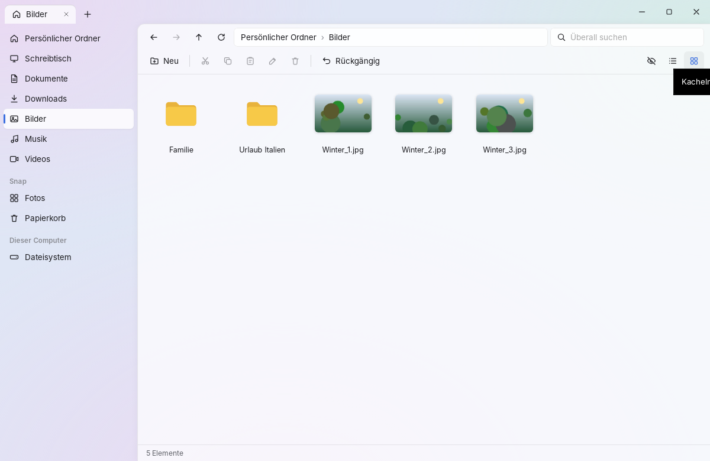
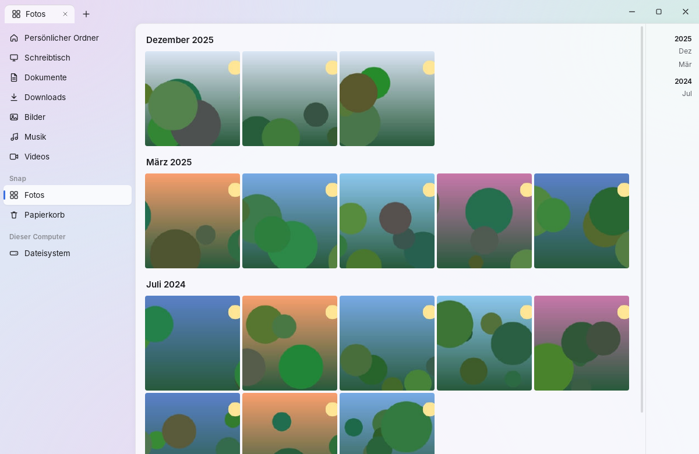

# Snap – Desktop-App

Explorer-Oberfläche für Snap auf Basis von Tauri v2 und React, im Fluent-Stil: Mica-Hintergrund,
Acryl-Flächen, Tabs in der Titelleiste.




Die App ist ein **Client des Snap-Dienstes** (`space-daemon`). Index, Sicherungen, Uploads und
Verbindungen laufen im Dienst weiter, auch wenn das Fenster geschlossen ist. Läuft der Dienst
nicht, bietet die App an, ihn zu starten: zuerst als systemd-Benutzerdienst `snap.service`, sonst
über `space-daemon start`.

## Funktionen (Phase 3a)

- **Navigation:** Tabs (Strg+T/W, Strg+Tab, mittlere Maustaste), Zurück/Vor/Hoch, Brotkrumen-Adressleiste
  (Strg+L für Texteingabe, `~` wird ersetzt), Seitenleiste mit Standardordnern.
- **Ansicht:** Details- oder Kachelansicht mit echten Vorschaubildern, Sortierung nach Name, Datum
  oder Größe, versteckte Dateien ein-/ausblenden. Große Ordner werden seitenweise nachgeladen.
- **Suche** über alle indexierten Orte (Enter).
- **Dateioperationen:**
  - Ausschneiden/Kopieren/Einfügen, Umbenennen (F2), neuer Ordner (Strg+Umschalt+N).
  - Ziehen und Ablegen; Strg beim Ablegen kopiert statt zu verschieben.
  - Papierkorb (Entf) mit Rückgängig (Strg+Z); endgültig löschen mit Umschalt+Entf.
  - Fortschrittsanzeige.
- **Papierkorb:** Wiederherstellen, leeren.
- **Vorschau:** Bilder groß, Videos über den lokalen Streaming-Server.
- **Fotos:** Zeitachse nach Aufnahmedatum, nach Monaten gruppiert, mit Sprungleiste.

Geplant (3b): Geräte und Kopplung, Sicherungen, Einstellungen, Freigabelinks, Speicheranalyse.

## Sicherheit

- **Keine allgemeine Brücke:** Die Web-Ansicht kann nur die typisierten Befehle in
  `src-tauri/src/commands.rs` aufrufen. Jeder Befehl baut genau eine Daemon-Anfrage und prüft
  seine Eingaben: absolute Pfade ohne `..`, begrenzte Längen und Mengen.
- **Native Bestätigung:** Endgültiges Löschen, Papierkorb leeren und das Öffnen ausführbarer oder
  riskanter Dateien (`.desktop`, Skripte, Programme …) bestätigt ein nativer Dialog. Der wird vom
  Rust-Teil angezeigt und kann von Skript in der Web-Ansicht weder ausgelöst noch weggeklickt
  werden.
- **Feindliche Dateinamen:** Namen werden nur als Text dargestellt (React escapt). Eine strenge
  CSP verbietet fremden und eingebetteten Code: keine Remote-Skripte, kein `eval`, keine Frames.
  Verbindungen sind nur zur App selbst und zum lokalen Streaming-Server erlaubt.
- **Minimale Rechte** (`src-tauri/capabilities/default.json`): nur Ereignisse und die eigene
  Fensterleiste. Die Web-Ansicht hat keine Datei-, Shell- oder Dialogrechte.
- **Vorschaubilder** kommen über das eigene Protokoll `thumb:`. Es ist nur lesend und liefert
  ausschließlich JPEG-Daten aus dem Cache des Dienstes.
- Dateien öffnen geschieht über `xdg-open` mit dem Pfad als einzelnem Argument, ohne Shell.

## Entwickeln

Voraussetzungen (Debian/Ubuntu):

```bash
sudo apt install libwebkit2gtk-4.1-dev libgtk-3-dev libsoup-3.0-dev librsvg2-dev libxdo-dev
```

Abhängigkeiten installieren:

```bash
npm ci
```

Entwicklungsmodus mit Neuladen:

```bash
npx tauri dev
```

Pakete bauen (`.deb`, AppImage):

```bash
npx tauri build
```

Der Rust-Teil ist ein eigener Cargo-Workspace (`src-tauri/`), damit Daemon und CLI ohne WebKitGTK
bauen.
